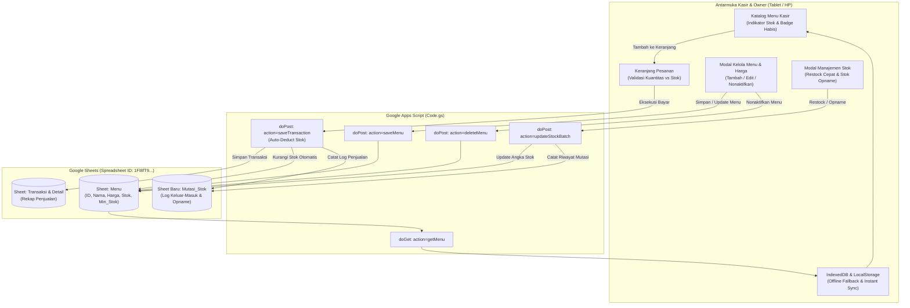

# Rencana Pengembangan & Brainstorming Fitur (Update Plan)
## POS Teras Foodies: CRUD Menu Mandiri & Manajemen Stok Komprehensif

**Tanggal:** 25 Oktober 2026  
**Status:** Selesai Diimplementasikan (Completed)  
**Tujuan Utama:** 
1. Memberikan akses penuh kepada pemilik/kasir untuk melakukan **CRUD (Create, Read, Update, Delete) Menu & Harga** langsung dari antarmuka POS tanpa perlu mengedit Google Sheets atau kode pemrograman secara manual.
2. Membangun **Sistem Manajemen Stok yang Lengkap, Komprehensif, dan Akurat**, namun dirancang **Sangat Praktis & Cepat Dioperasikan** untuk ritme kerja cepat gerai kuliner F&B (Dimsum & Minuman).

---

## 1. Latar Belakang & Identifikasi Masalah

### 1.1 Kondisi Saat Ini (As-Is)
- **Menu Terkunci ke Backend/Sheet**: Setiap kali ada penambahan menu baru (seperti contoh kasus *Es Chocolatos*), perubahan harga, atau pergantian varian, user harus membuka Google Sheets langsung atau meminta bantuan teknis/developer.
- **Ketiadaan Kontrol Menu di UI POS**: Antarmuka kasir hanya bersifat *Read-Only* terhadap katalog menu.
- **Stok Belum Terintegrasi Penuh**: Kolom `Stok_Tersedia` di Google Sheets saat ini terisi nilai dummy (999), belum berkurang otomatis saat terjadi penjualan, tidak ada log riwayat barang keluar-masuk, dan tidak ada fitur restock harian yang praktis.

### 1.2 Sasaran Pengembangan (To-Be)
- **Kemandirian Operasional 100%**: Pemilik toko dapat menambah menu baru, menaikkan/menurunkan harga, mengganti kategori, dan menonaktifkan menu habis hanya dengan beberapa ketukan di layar tablet/HP kasir.
- **Sistem Stok Real-Time & Praktis**:
  - Penjualan kasir **otomatis memotong stok** item terkait.
  - Terdapat **indikator visual jelas** di katalog (Stok Aman, Stok Menipis, Habis).
  - Kasir tidak bisa menjual item yang stoknya sudah 0 (mencegah komplain pelanggan).
  - Fitur **Restock Cepat (Quick Restock)** dengan tombol sekali ketuk (+5, +10, +20, +50).
  - Fitur **Stok Opname / Penyesuaian Harian** di akhir shift untuk mendeteksi selisih fisik (rusak/basi/bonus).
  - Seluruh mutasi stok tercatat rapi di lembar kerja Google Sheets `Mutasi_Stok` sebagai jejak audit (audit trail) transparan bagi pemilik gerai.

---

## 2. Diagram Alur Sistem (System Architecture)



---

## 3. Fitur 1: Manajemen Menu & Harga Mandiri (CRUD)

### 3.1 Konsep & Pengalaman Pengguna (UX/UI)
Agar pengoperasian tetap mudah di tablet kasir tanpa membingungkan staf biasa:
1. **Navigasi Akses**: 
   - Tombol baru di Header: **"Kelola Menu"** (disandingkan dengan Rekap Penjualan).
   - Opsi proteksi keamanan: Saat dibuka, kasir dapat memasukkan **PIN Kasir/Owner** (default `8888` / `1234`) untuk mencegah perubahan harga oleh pihak yang tidak berwenang.
2. **Daftar Menu Interaktif**:
   - Tampilan tabel/kartu modern yang memuat: Foto/Ikon, Nama Produk, Kategori, Varian, Harga Modal (HPP), Harga Jual, Margin Laba, Status (Aktif/Nonaktif).
   - Fitur pencarian cepat dan filter kategori.
3. **Form Tambah / Edit Menu (Modal)**:
   - **Nama Menu**: Contoh: `Es Chocolatos`
   - **Kategori**: Pilihan dropdown (*Dimsum Ori, Dimsum Mentai, Hot Lava, Wonton, Basreng, Mie Jebew, Minuman, Birthday Dimsum*) atau input kategori baru.
   - **Varian**: Contoh: `Gelas`, `4 pcs`, `Porsi`, `Jumbo`.
   - **Harga Jual (Rp)**: Contoh: `5000` (diformat otomatis dengan pemisah ribuan).
   - **Harga Modal / HPP (Rp)**: Contoh: `2500` (untuk menghitung estimasi keuntungan).
   - **Mode Stok**: Radio button (*Berstok / Dihitung* vs *Unlimited / Tanpa Batas*).
   - **Stok Awal**: Jumlah stok fisik saat menu dibuat.
   - **Batas Peringatan Stok Menipis (Min Alert)**: Default 5 pcs.
   - **Keterangan Singkat**: Opsional.
4. **Operasi Edit Cepat (Quick Inline Price Edit)**:
   - Tombol cepat untuk mengubah harga jual seketika tanpa harus membuka form panjang.
5. **Penghapusan / Nonaktifkan Menu (Safe Soft-Delete)**:
   - Jika menu dihapus, sistem **TIDAK langsung menghapus baris secara fisik** di Google Sheets agar riwayat transaksi masa lalu tidak *corrupt*, melainkan mengubah statusnya menjadi `Nonaktif` (Soft Delete).
   - Opsi *Hard Delete* (hapus permanen dari sheet) hanya tersedia dengan konfirmasi peringatan bertingkat (SweetAlert2).

---

## 4. Fitur 2: Manajemen Stok Lengkap, Komprehensif & Mudah

### 4.1 Filosofi Desain: "Komprehensif tapi Anti-Ribet"
Di jam operasional sibuk gerai kuliner, kasir **tidak boleh dibebani** perhitungan gramasi resep yang rumit (seperti berapa gram tepung atau bumbu per porsi).  
Sistem stok Teras Foodies difokuskan pada **Level Unit Jual & Porsi Olahan (Ready-to-Cook & Packaging)**:
- **Porsi Dimsum / Wonton / Basreng**: Dihitung dalam satuan porsi (misal: 4 pcs, 6 pcs, 8 pcs, atau pack beku).
- **Mie Jebew**: Dihitung per porsi mie siap masak.
- **Minuman Sachet & Botol**: Dihitung per sachet (Chocolatos, Milo, Nutrisari, Goodday) atau cup kemasan.
- **Bahan Tanpa Batas (Unlimited)**: Menu seperti Es Teh Manis dapat disetel sebagai *Unlimited* jika persediaan selalu melimpah, sehingga kasir tidak dibebani input stok.

### 4.2 Empat Pilar Manajemen Stok

#### Pilar A: Pemotongan Stok Otomatis Saat Penjualan (Auto-Deduction)
- Setiap kali transaksi diselesaikan (`handleSaveTransaction`), sistem di Google Apps Script secara otomatis mengurangi `Stok_Tersedia` di sheet `Menu` untuk menu yang bertipe tracked stock.
- Bersamaan dengan itu, baris mutasi keluar otomatis dicatat di sheet `Mutasi_Stok` bertipe `PENJUALAN` dengan menyertakan Nomor Transaksi.
- **Dukungan Offline**: Jika kasir offline, stok lokal di `IndexedDB` tetap berkurang langsung. Begitu koneksi online kembali, proses sinkronisasi batch akan memvalidasi dan memotong stok di Google Sheets.

#### Pilar B: Indikator Visual Pintar di Katalog Kasir
Setiap kartu menu pada layar kasir menampilkan status stok dinamis:
- 🟢 **Stok Tersedia (> 5 porsi)**: Badge netral/hijau lembut menampilkan sisa stok (misal: `Stok: 24`).
- 🟠 **Stok Menipis (1 - 5 porsi)**: Badge oranye mencolok bertuliskan `⚠️ Sisa 3!`, memberi sinyal visual ke kasir untuk segera mengabari dapur/mengambil stok tambahan.
- 🔴 **Stok Habis (0 porsi)**: 
  - Kartu menu diredupkan (opacity 60%).
  - Badge merah bertuliskan `HABIS`.
  - Tombol klik dinonaktifkan atau memunculkan peringatan instan: *"Menu ini sedang habis dan tidak dapat ditambahkan ke pesanan."*

#### Pilar C: Fitur Restock Cepat (Quick Restock)
Saat pemilik atau pemasok membawa stok baru di pagi hari atau pergantian shift:
- Buka tab **"Manajemen Stok"**.
- Tampil daftar seluruh menu dengan sisa stoknya saat ini.
- Terdapat tombol cepat sekali ketuk: **`+5`**, **`+10`**, **`+20`**, **`+50`**, atau input angka manual.
- Klik tombol **"Simpan Perubahan Stok"**: Stok di Google Sheets langsung ter-update seketika, dan tercatat di riwayat mutasi sebagai `RESTOCK_MASUK`.
- *Waktu yang dibutuhkan kasir: kurang dari 30 detik untuk seluruh menu!*

#### Pilar D: Stok Opname & Penyesuaian Akhir Shift (Stock Audit)
- Di akhir shift atau saat tutup gerai, kasir/owner melakukan penghitungan fisik singkat.
- Menu **Stok Opname** menampilkan kolom:  
  `[Nama Menu] | [Stok Sistem] | [Input Fisik Aktual] | [Selisih Otomatis]`
- Jika ada selisih (misal sistem mencatat 10 porsi, tapi fisik tinggal 8 porsi karena 2 porsi basi/rusak saat dikukus):
  - Kasir memilih alasan pada dropdown keterangan: `Basi/Kukus Rusak`, `Bonus Pelanggan`, `Selisih Hitung`, atau `Konsumsi Sendiri`.
  - Sistem mengoreksi stok sistem ke angka fisik riil dan mencatat mutasi `OPNAME_PENYESUAIAN` di Google Sheets.
  - Pemilik gerai mendapatkan laporan akurat atas setiap potensi kebocoran bahan makanan (*food waste / loss*).

---

## 5. Rencana Perubahan Struktur Database Google Sheets

### 5.1 Perubahan pada Sheet `Menu`
Menambahkan kolom batas peringatan stok:
| Kolom | Nama Field | Tipe | Contoh Nilai | Keterangan |
| :---: | :--- | :--- | :--- | :--- |
| **A** | `ID_Menu` | String | `MNU-027` | ID unik menu |
| **B** | `Kategori` | String | `Minuman` | Kategori produk |
| **C** | `Nama_Menu` | String | `Es Chocolatos` | Nama menu |
| **D** | `Varian` | String | `Gelas` | Ukuran / porsi |
| **E** | `Harga_Jual` | Number | `5000` | Harga transaksi |
| **F** | `Harga_Modal` | Number | `2500` | Estimasi HPP |
| **G** | `Stok_Tersedia` | Mixed | `25` atau `Unlimited` | Angka stok terkini |
| **H** | `Status_Aktif` | String | `Aktif` / `Nonaktif` | Status tayang menu |
| **I** | `Gambar_URL` | String | (URL / base64 kosong) | Visual produk |
| **J** | `Keterangan` | String | `Es cokelat dingin segar` | Deskripsi singkat |
| **K** *(Baru)* | `Min_Stok_Alert` | Number | `5` | Batas peringatan menipis |

### 5.2 Pembuatan Sheet Baru: `Mutasi_Stok`
Menjadi buku besar audit keluar-masuk barang yang 100% otomatis:
| Kolom | Nama Field | Tipe | Contoh Nilai | Keterangan |
| :---: | :--- | :--- | :--- | :--- |
| **A** | `ID_Mutasi` | String | `STK-20261025-160001-01` | ID unik log mutasi |
| **B** | `Tanggal` | String | `25/10/2026` | Tanggal transaksi / audit |
| **C** | `Jam` | String | `16:00:01` | Waktu kejadian |
| **D** | `ID_Menu` | String | `MNU-027` | Kode menu yang termutasi |
| **E** | `Nama_Menu` | String | `Es Chocolatos (Gelas)` | Nama menu & varian |
| **F** | `Tipe_Mutasi` | String | `PENJUALAN` / `RESTOCK_MASUK` / `OPNAME_PENYESUAIAN` / `BATAL` | Jenis kejadian |
| **G** | `Qty_Mutasi` | Number | `-2` atau `+20` | Perubahan jumlah |
| **H** | `Stok_Sebelum` | Number | `10` | Posisi stok sebelum |
| **I** | `Stok_Sesudah` | Number | `8` | Posisi stok sesudah |
| **J** | `Keterangan` | String | `Transaksi TRF-20261025-0012` | Catatan referensi |
| **K** | `Operator` | String | `Alfian` | Kasir / penanggung jawab |

---

## 6. Spesifikasi API Endpoint Google Apps Script (`Code.gs`)

Untuk mendukung fitur ini, `Code.gs` akan diperluas dengan aksi-aksi berikut:

### 6.1 `doPost` Actions Baru:

1. **`action: "saveMenu"`**
   - **Tujuan**: Menambahkan menu baru atau memperbarui data menu yang sudah ada (Create / Update).
   - **Payload**:
     ```json
     {
       "action": "saveMenu",
       "data": {
         "id": "MNU-027", // Jika kosong, backend otomatis generate ID baru
         "kategori": "Minuman",
         "nama": "Es Chocolatos",
         "varian": "Gelas",
         "harga": 5000,
         "modal": 2500,
         "stok": 50, // atau "Unlimited"
         "status": "Aktif",
         "keterangan": "Es cokelat nikmat dingin segar",
         "minStok": 5
       }
     }
     ```
   - **Respon**: `{ "status": "success", "message": "Menu berhasil disimpan.", "data": { ... } }`

2. **`action: "deleteMenu"`**
   - **Tujuan**: Menghapus atau menonaktifkan menu (Soft Delete).
   - **Payload**:
     ```json
     {
       "action": "deleteMenu",
       "id": "MNU-027",
       "hardDelete": false // true = hapus baris; false = set status 'Nonaktif'
     }
     ```

3. **`action: "updateStockBatch"`**
   - **Tujuan**: Menangani Restock Cepat dan Stok Opname multi-item dalam satu kali kirim HTTP.
   - **Payload**:
     ```json
     {
       "action": "updateStockBatch",
       "tipeMutasi": "RESTOCK_MASUK", // atau "OPNAME_PENYESUAIAN"
       "operator": "Alfian",
       "keterangan": "Restock kiriman bahan pagi",
       "items": [
         { "id": "MNU-001", "stokBaru": 40, "qtyMutasi": 20 },
         { "id": "MNU-027", "stokBaru": 50, "qtyMutasi": 30 }
       ]
     }
     ```

4. **Pembaruan pada `action: "saveTransaction"`**:
   - Backend membaca array `trx.items`.
   - Mengurangi kolom `Stok_Tersedia` di sheet `Menu` secara sinkron.
   - Menambahkan catatan ke sheet `Mutasi_Stok` secara otomatis.

---

## 7. Rencana Desain Antarmuka (UI/UX) Frontend

### 7.1 Tombol Navigasi Baru di Header
- Menambahkan tombol **`[ 📦 Menu & Stok ]`** di bilah atas aplikasi samping tombol *Rekap Penjualan*.

### 7.2 Struktur Tab Modal "Manajemen Menu & Stok"
Modal dibuat berukuran lega (Full Modal / Tablet Optimized) dengan 3 sub-tab:
1. **Tab 1: 📋 Katalog Menu (CRUD)**
   - Tombol utama: `+ Tambah Menu Baru` (Membuka popup form input).
   - Search bar khusus untuk mencari nama menu di tabel kelola.
   - Tabel responsif berisi daftar menu dengan tombol aksi cepat:
     - ✏️ Edit (Buka popup edit form lengkap).
     - 💲 Ganti Harga (Popup cepat ubah harga jual).
     - 👁️ Toggle Aktif/Nonaktif (Switch tombol on/off).
2. **Tab 2: ⚡ Restock Cepat (Quick Restock)**
   - Tampilan ringkas kartu produk.
   - Input angka penambahan cepat (+5, +10, +20, +50).
   - Kolom catatan restock (misal: "Beli di agen", "Dropping gudang").
   - Tombol aksi utama: `Simpan Penambahan Stok`.
3. **Tab 3: 📝 Stok Opname (Cek Fisik Akhir Shift)**
   - Daftar seluruh menu dengan angka sisa di sistem saat ini.
   - Input fisik aktual: Kasir tinggal memasukkan sisa fisik yang ada di gerai.
   - Kolom selisih terhitung otomatis (berwarna merah jika minus, hijau jika pas/plus).
   - Pilihan alasan selisih jika ada ketidaksesuaian.
   - Tombol aksi utama: `Sesuaikan & Tutup Opname`.

---

## 8. Rencana Tahapan Eksekusi (Roadmap Pelaksanaan)

| Tahap | Fokus Pekerjaan | Status | Estimasi Berkas Terkait |
| :---: | :--- | :---: | :--- |
| **Fase 1** | **Backend Apps Script (`Code.gs`)**<br>- Perbarui `setupDatabase()` untuk kolom baru sheet `Menu` & inisialisasi sheet `Mutasi_Stok`<br>- Implementasikan fungsi `handleSaveMenu()`, `handleDeleteMenu()`, dan `handleUpdateStockBatch()`<br>- Tambahkan auto-deduct stok pada `handleSaveTransaction()` | ✅ **Selesai** | [`Code.gs`](file:///D:/1.%20MIZTERGOOD/04%20-%20Keuangan%20dan%20Bisnis/JASA/14.%20PAK%20ALFIAN/POS%20DIMSUM/Code.gs) |
| **Fase 2** | **Desain UI Markup & CSS (`index.html` & `style.css`)**<br>- Tombol akses di header kasir<br>- Markup Modal "Manajemen Menu & Stok" dengan 3 tab interaktif<br>- Form modal Tambah/Edit Menu dan modal Ganti Harga Cepat<br>- Indikator visual badge stok di kartu menu kasir (Aman, Menipis, Habis) | ✅ **Selesai** | [`index.html`](file:///D:/1.%20MIZTERGOOD/04%20-%20Keuangan%20dan%20Bisnis/JASA/14.%20PAK%20ALFIAN/POS%20DIMSUM/index.html)<br>[`css/style.css`](file:///D:/1.%20MIZTERGOOD/04%20-%20Keuangan%20dan%20Bisnis/JASA/14.%20PAK%20ALFIAN/POS%20DIMSUM/css/style.css) |
| **Fase 3** | **Logika Frontend & Validasi Keranjang (`app.js`, `cart.js`, `db.js`)**<br>- Logika CRUD Menu (Fetch, Simpan, Edit, Soft-Delete)<br>- Logika Restock Cepat dan Stok Opname<br>- Guard di `cart.js`: Cegah penambahan item ke keranjang melebihi sisa stok<br>- Pembaruan cache lokal IndexedDB agar stok tetap valid saat offline | ✅ **Selesai** | [`js/app.js`](file:///D:/1.%20MIZTERGOOD/04%20-%20Keuangan%20dan%20Bisnis/JASA/14.%20PAK%20ALFIAN/POS%20DIMSUM/js/app.js)<br>[`js/cart.js`](file:///D:/1.%20MIZTERGOOD/04%20-%20Keuangan%20dan%20Bisnis/JASA/14.%20PAK%20ALFIAN/POS%20DIMSUM/js/cart.js)<br>[`js/db.js`](file:///D:/1.%20MIZTERGOOD/04%20-%20Keuangan%20dan%20Bisnis/JASA/14.%20PAK%20ALFIAN/POS%20DIMSUM/js/db.js) |
| **Fase 4** | **Testing Komprehensif & Verifikasi Skenario**<br>- Tes tambah menu baru via UI (misal: tes tambah Es Chocolatos)<br>- Tes ubah harga jual dan cek apakah langsung berlaku di keranjang<br>- Tes penjualan memotong stok secara real-time di sheet Google<br>- Tes badge habis dan validasi saat stok mencapai 0<br>- Tes Restock Cepat dan Stok Opname beserta verifikasi log sheet `Mutasi_Stok` | ✅ **Selesai** | Seluruh Modul |

---

## 9. Kesimpulan & Nilai Tambah bagi Pemilik Gerai

Dengan menerapkan rencana pembaruan ini:
1. **Fleksibilitas Penuh**: Pemilik gerai dapat merespons tren menu kuliner atau perubahan harga bahan baku seketika langsung dari smartphone atau tablet kasir tanpa perlu ketergantungan pada developer.
2. **Pengendalian Stok Tanpa Beban Kerja Berlebih**: Kasir tidak perlu menghitung bahan baku yang rumit, namun pemilik tetap memiliki visibilitas 100% atas sisa stok porsi dan riwayat mutasi setiap hari.
3. **Mencegah Kerugian & Ketidaksesuaian Kasir**: Stok fisik dan penjualan tercatat sinkron, meminimalisir risiko selisih porsi atau penjualan yang tidak tercatat.
